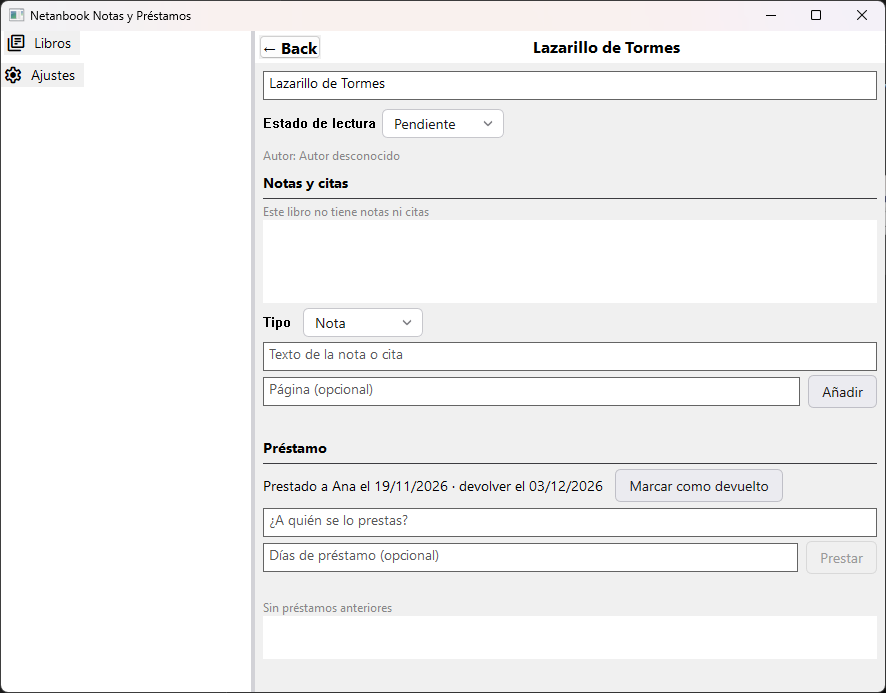
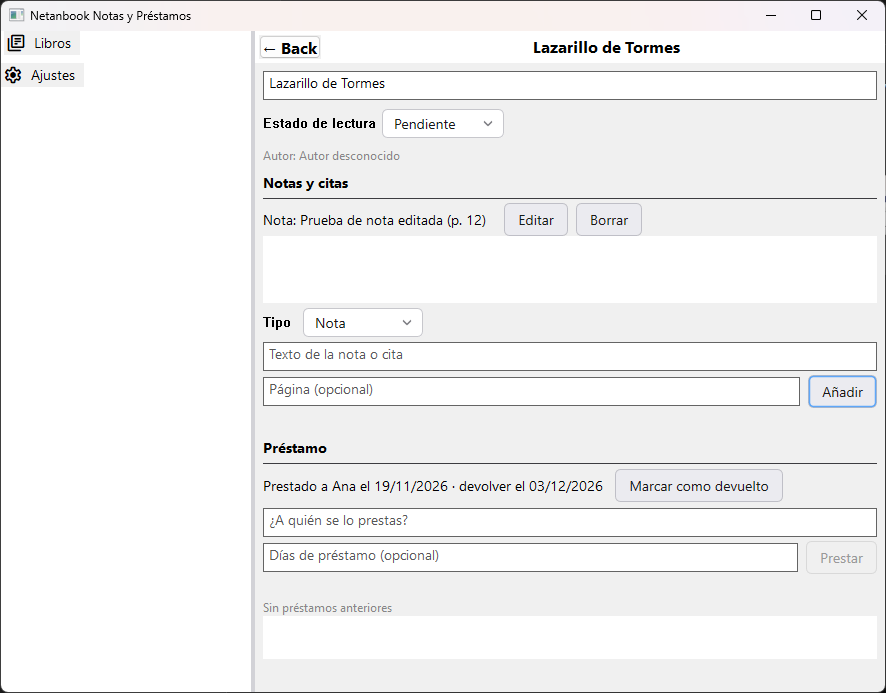
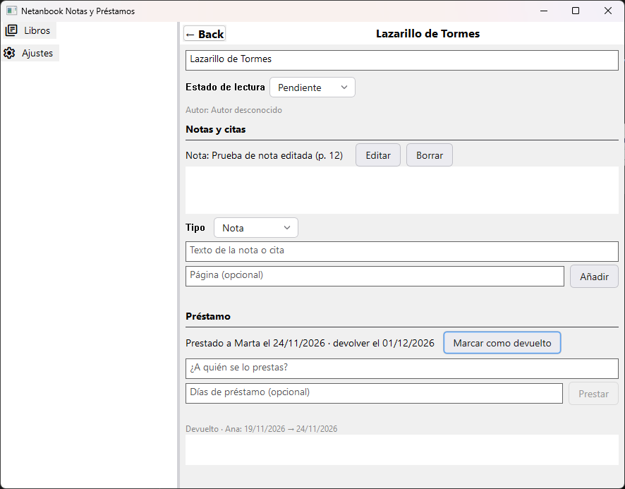
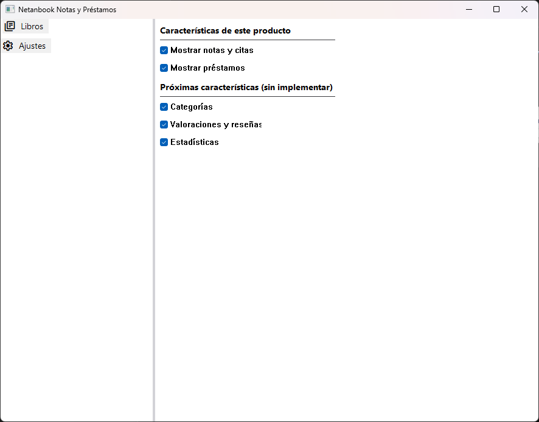
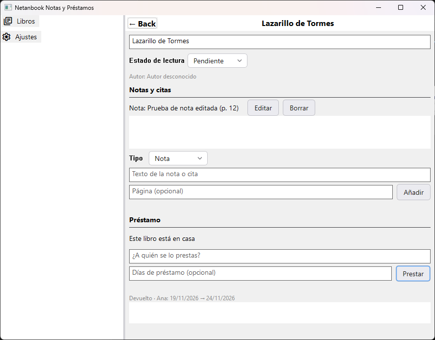
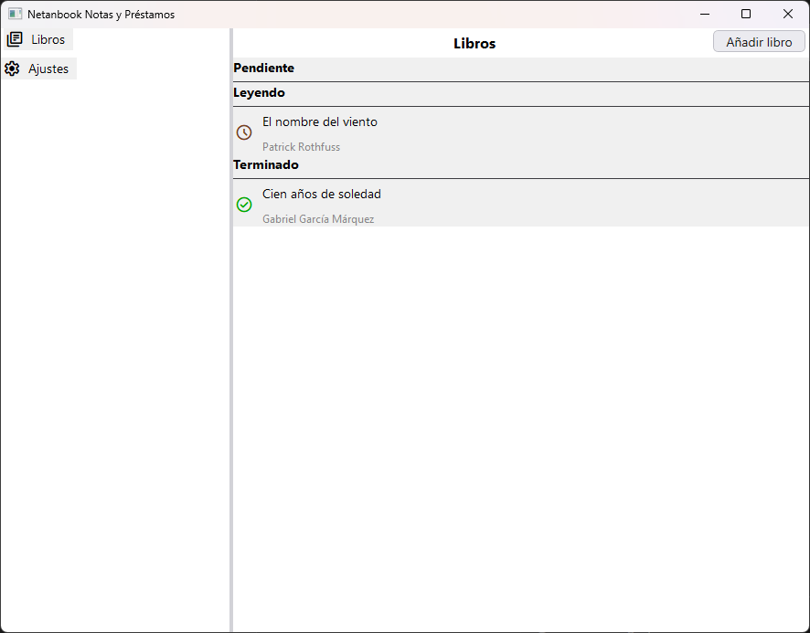

# Notas de parche · Rama `Marcos` (Netanbook)

**Autor:** Marcos Sánchez García · **Periodo:** 20 a 24/11/2026 · **Repositorio:** `uallps/bookapp-netanbook`, rama `Marcos`

**Estado:** todo está subido en 4 commits (`488c9ec`, `d47e5da`, `ff3d3a9` y `a135c38`), y la CI de `a135c38` pasa en verde en macOS, Linux y Windows. Queda un commit pequeño pendiente (ver [§8](#8-qué-entró-en-el-commit-a135c38-y-qué-queda-pendiente)).

## Resumen

- **F2 · Notas y citas** (común): completa. Se pueden crear, listar, **editar** y borrar anotaciones de un libro, como pide `docs/sesion-3.md`.
- **O2 · Préstamos** (original): completa. Registra a quién se presta un libro físico, cuándo y hasta cuándo, si se ha devuelto, y guarda el historial.
- **Verificación:**
  - las 5 combinaciones de compilación, sin avisos en nuestro código;
  - 20 pruebas unitarias;
  - una prueba de interfaz real en Windows, que pasa en tu equipo y en la CI;
  - la CI de GitHub en verde en los tres sistemas con `a135c38`, incluidos los targets nuevos de Xcode.
- **Xcode:** hay dos targets nuevos, «Netanbook Notas» y «Netanbook Prestamos». Compilan en la CI de macOS.
- **Windows:** Libros ya no se queda encogido al volver de Ajustes.
- **Pendiente:** el README de la rama sigue describiendo BookApp (ver [§9](#9-pendiente-y-riesgos-conocidos)).

## 1. Qué se ha hecho, en orden

| Fecha | Qué | Dónde |
|---|---|---|
| 20/11 | Subida del proyecto Netanbook a la rama `Marcos`, sin borrar nada de BookApp. Se dejaron como estaban `.gitignore`, `Compat/SwiftUI/SwiftUI.swift`, `Package.resolved` y `README.md` | commit `488c9ec` |
| 20/11 | Swift 6.4.2 sustituido por 6.3.3, la versión de la CI. Con 6.4, SwiftOpenUI no compila en Windows | equipo local |
| 20/11 | F2 Notas y citas, primera versión | commit `d47e5da` |
| 20/11 | `Package.swift` de Netanbook, con el trait `Notas` | commit `ff3d3a9` (CI en verde) |
| 24/11 | O2 Préstamos | commit `a135c38` |
| 24/11 | Revisión completa, correcciones, prueba de interfaz y estas notas | commit `a135c38` |
| 24/11 | Targets de Xcode «Netanbook Notas» y «Netanbook Prestamos» | commit `a135c38` |
| 24/11 | Arreglo en Windows: al volver de Ajustes, Libros se quedaba encogido | commit `a135c38`; falta limitar el `Color.clear` a Windows (commit pendiente) |

## 2. F2 · Notas y citas

**Qué hace:** guarda notas personales y citas de cada libro. Una cita puede llevar la página.

**Cómo se usa:** en el detalle de un libro aparece la sección «Notas y citas». Contiene:

- La lista de anotaciones, de la más reciente a la más antigua, cada una con los botones **Editar** y **Borrar**.
- Un formulario con el tipo (Nota o Cita), el texto, la página (opcional) y el botón **Añadir**.
- Al pulsar **Editar**, la anotación pasa al formulario y aparecen **Guardar cambios** y **Cancelar**.
- En Ajustes, el interruptor «Mostrar notas y citas» muestra u oculta la sección (flag `showNotes`).

**Reglas:**

- El texto es obligatorio. Si está vacío o solo tiene espacios, no se guarda y aparece el aviso «Escribe el texto de la nota o de la cita».
- La página, si se escribe, tiene que ser un número mayor que 0. Si no lo es, aparece un aviso y no se borra lo escrito.
- Al editar con el texto vacío o sobre una anotación que no existe, no cambia nada.
- Al eliminar un libro se eliminan sus anotaciones. Si el libro no tenía ninguna, no se toca el fichero.
- Un libro tiene de 0 a N anotaciones. El `Book` del Core no cambia: cada anotación apunta a su libro con `bookID`.

**Ficheros** (`Netanbook/Features/NotasYCitas/`):

- `Models/BookNote.swift`
- `Persistence/BookNotesStorage.swift`: JSON en `Documentos\netanbook-notas.json`, con escritura atómica, y una versión en memoria para las pruebas.
- `ViewModels/BookNotesViewModel.swift`
- `Views/BookNotesView.swift`

**Compilación:** solo con el trait `Notas`, por ejemplo `swift run --traits Notas Netanbook`. En Xcode, con el target «Netanbook Notas».

## 3. O2 · Préstamos

**Qué hace:** registra a quién se ha prestado un libro físico, la fecha, la fecha prevista de devolución y si ya se ha devuelto.

**Cómo se usa:** en el detalle del libro aparece la sección «Préstamo». Contiene:

- **La fila de estado:**
  - Si el libro está prestado: «Prestado a X el dd/MM/aaaa · devolver el dd/MM/aaaa», con «(¡vencido!)» si ya pasó la fecha, y el botón **Marcar como devuelto**.
  - Si no: «Este libro está en casa».
- **Un formulario** con la persona, los días de préstamo (opcional) y el botón **Prestar**. El botón está desactivado mientras el libro está prestado.
- **El historial** de préstamos devueltos: «Devuelto · Ana: 19/11/2026 → 24/11/2026».
- En Ajustes, el interruptor «Mostrar préstamos» muestra u oculta la sección (flag `showLoans`, nuevo en `AppConfig`).

**Reglas:**

- La persona es obligatoria. Si falta, aparece el aviso «Escribe a quién se lo prestas».
- Un libro solo puede tener **un préstamo abierto**. Para volver a prestarlo, antes hay que devolverlo.
- Los días son opcionales. Si se indican, tienen que ser mayores que 0, y la fecha prevista se calcula en **días de calendario**.
- Un préstamo está **vencido** desde el día siguiente al previsto. El mismo día de la devolución todavía no cuenta como vencido.
- Al eliminar un libro se eliminan sus préstamos. Si no tenía ninguno, no se toca el fichero.
- Un libro tiene de 0 a N préstamos, como mucho uno abierto.

**Ficheros** (`Netanbook/Features/Prestamos/`):

- `Models/BookLoan.swift`
- `Persistence/BookLoansStorage.swift`: JSON en `Documentos\netanbook-prestamos.json`, con escritura atómica, y una versión en memoria para las pruebas.
- `ViewModels/BookLoansViewModel.swift`
- `Views/BookLoansView.swift`

**Compilación:** solo con el trait `Prestamos`, por ejemplo `swift run --traits Prestamos Netanbook`. Los traits se combinan: `--traits Progreso,Notas,Prestamos`. En Xcode, con el target «Netanbook Prestamos». El nombre va sin tilde, como el trait y la carpeta, porque el nombre del target forma el del módulo de Swift. La ventana sí muestra «Netanbook Préstamos».

### Cómo se ve (Windows, SwiftOpenUI)

| Detalle al abrir | Nota editada | Préstamo devuelto y vuelto a prestar |
|---|---|---|
|  |  |  |

| Ajustes | En casa, con historial | Tras eliminar el libro |
|---|---|---|
|  |  |  |

## 4. La revisión: qué se encontró y cómo se ha corregido

Un revisor independiente leyó todo el código y la documentación del repositorio (unas 26 600 palabras). Después se comprobaron las afirmaciones decisivas contra el original, se compiló, se probó y se ejecutó la app.

| # | Problema | Gravedad | Corrección |
|---|---|---|---|
| 1 | **F2 no permitía editar.** `docs/sesion-3.md` pide «Crear, listar, editar y borrar anotaciones de un libro» | Alta | `updateNote` en el ViewModel; botones Editar, Guardar cambios y Cancelar; 2 pruebas unitarias y un paso en la prueba de interfaz |
| 2 | **En Windows, las secciones de F2 y O2 no se actualizaban bien.** Al añadir una nota no se veía, o la sección de notas tapaba la de préstamo y dejaba el botón «Añadir» inalcanzable (ver [§6](#6-problemas-de-swiftopenui-en-windows-no-son-nuestros)) | Alta (Windows) | Cada sección lee sus datos en su propio `body` y tiene siempre el mismo alto: listas desplazables de alto fijo, la línea de aviso siempre presente y formularios compactos. Comprobado con la prueba de interfaz |
| 3 | **El detalle del libro (Core) guardaba los ViewModels de F2 y O2**, en contra de la regla de la sesión 4 («recibe [...] las acciones como closures y no conoce ningún ViewModel») | Media | El listado pasa closures (`NotesForBook`, `LoansForBook`). Ni el detalle ni las vistas de F2 y O2 conocen los ViewModels |
| 4 | **La CI no compilaba ni probaba F2 y O2.** Solo compilaba los productos base y Progreso | Media | Linux compila con `Notas,Prestamos` y pasa las 20 pruebas. Windows ejecuta la prueba de interfaz de F2 y O2, de momento como paso informativo |
| 5 | **El `.gitignore` de la rama (el de BookApp) no ignoraba** `shots/`, `.vscode/*`, `DerivedData/` ni `.swiftpm/`. VS Code ya había creado `.vscode/launch.json` | Media | Se han añadido las entradas del `.gitignore` de Netanbook |
| 6 | Los datos no válidos se descartaban en silencio (texto vacío, página o días no válidos, nombre vacío) | Baja | Avisos en la propia sección; lo escrito no se borra |
| 7 | El vencimiento se calculaba en segundos (fecha + días × 86 400 s) | Baja | Días de calendario; vencido desde el día siguiente al previsto |
| 8 | La escritura de los JSON de F2 y O2 no era atómica | Baja | `write(to:options: .atomic)` |
| 9 | Borrar un libro sin notas ni préstamos reescribía sus ficheros | Baja | Solo se guarda si algo cambia (con prueba) |
| 10 | El nombre del producto con tres traits era «Netanbook Progreso y Notas y Préstamos» | Baja | «Netanbook Progreso, Notas y Préstamos». «Netanbook» y «Netanbook Progreso» no cambian |
| 11 | Ajustes mostraba «Notas y citas» como «sin implementar» en los productos sin F2, y ahí no hacía nada | Baja | Ya no aparece en esa lista |
| 12 | Comentarios que ya no eran ciertos en `AppConfig` («cinco características comunes»), `SettingsView` («F2–F5 todavía no tienen código»), el detalle, el listado y `Package.swift` | Baja | Actualizados |
| 13 | Las pruebas de F2 y O2 estaban dentro del fichero de pruebas del listado | Baja | Ahora tienen ficheros propios: `BookNotesViewModelTests.swift` y `BookLoansViewModelTests.swift` |
| 14 | `DateFormatter` se creaba en cada dibujo. Las vistas de F2 y O2 usaban miembros de Foundation sin importarlo (Xcode activa `MemberImportVisibility`) | Baja | Un único formateador estático; `import Foundation` añadido |
| 15 | **F2 y O2 no se podían compilar en Xcode**: solo existían los targets «Netanbook» y «Netanbook Progreso» | Media | Targets «Netanbook Notas» y «Netanbook Prestamos», copias exactas de «Netanbook Progreso» salvo el identificador del paquete y la condición de compilación. La CI de macOS compila los cuatro esquemas |
| 16 | **En Windows, al volver de Ajustes a Libros, la sección se quedaba encogida** (200 × 232 píxeles) hasta redimensionar la ventana. Pasaba también en el producto base, así que lo notaba cualquiera que usara la app | Alta (Windows) | `NetanbookApp.swift`: la sección elegida vive en un objeto observable (`AppNavigation`), y la barra lateral y la sección son vistas propias. Al cambiar de sección solo se reconstruye la sección, que recoloca a tamaño completo lo que monta. En Windows, un `Color.clear` detrás de la sección avisa desde el principio de que el detalle ocupa todo el sitio. Solo en Windows: en Linux (GTK) el `Color` podría quedar encima de la lista. La prueba de interfaz comprueba el tamaño al volver de Ajustes |

**Cosas que se comprobaron y no eran un problema:**

- **Avisos del compilador:** no hay avisos de «variable nunca mutada». Se comprobó que el compilador sí muestra avisos en este entorno.
- **Ficheros de BookApp que se quedaron en la rama:** `Package.resolved` y `Compat` solo difieren de los de Netanbook en el `originHash` y en un comentario, y la rama compila con ellos.
- **Proyecto de Xcode:** no hace referencia a los ficheros movidos, porque usa carpetas sincronizadas.

## 5. Verificación

**CI de GitHub** (rama `Marcos`):

- `ff3d3a9`: macOS ✅, Linux ✅ y Windows ✅.
- `488c9ec` y `d47e5da` fallaron en Linux y Windows porque `Package.swift` todavía era el de BookApp. macOS pasó en las tres, así que mover los ficheros no rompe Xcode.

**Local** (Windows, Swift 6.3.3), sobre la copia de la rama:

| Compilación (`swift build`) | Resultado |
|---|---|
| sin traits (producto base) | ✅ sin avisos en nuestro código |
| `--traits Progreso` | ✅ |
| `--traits Notas` | ✅ |
| `--traits Prestamos` | ✅ |
| `--traits Progreso,Notas,Prestamos` | ✅ |

| Pruebas (`swift test`) | Pruebas | Fallos |
|---|---|---|
| sin traits | 5 (Core) | 0 |
| `--traits Notas` | 12 (5 + 7 de F2) | 0 |
| `--traits Prestamos` | 13 (5 + 8 de O2) | 0 |
| `--traits Progreso,Notas,Prestamos` | 20 | 0 |

**Interfaz en Windows** (`scripts/probar-notas-prestamos.ps1`): pasó tres veces, la última con la comprobación de tamaño nueva. Comprueba en la app real:

1. Ajustes muestra los interruptores de F2 y O2.
2. Al abrir el libro se ven las dos secciones.
3. Al añadir una nota con el texto vacío, aparece el aviso.
4. Se crea una nota con página, se edita y se crea y borra una segunda nota.
5. Se devuelve el préstamo de ejemplo, que pasa al historial y se ve.
6. Al prestar sin nombre, aparece el aviso.
7. Se presta el libro a otra persona con fecha de devolución.
8. Tras reiniciar la app se conservan la nota, el préstamo y el historial.
9. Al eliminar el libro se borran sus notas y sus préstamos del JSON, y se conservan los de los demás libros.
10. En cada paso, ningún control se superpone a otro.
11. Al volver de Ajustes a Libros, el listado y el detalle ocupan todo el sitio.

**Arreglo de Libros encogido** (Windows, ventana de 900 × 700). El tamaño del contenedor de Libros, antes y después:

| | Al arrancar | Tras Ajustes → Libros |
|---|---|---|
| Antes del arreglo | 630 × 661 | **200 × 232** |
| Con el arreglo | 630 × 661 | 630 × 661, sin redimensionar |

Con el arreglo, el clic sobre un libro llega a su fila y abre el detalle, tanto al arrancar como tras pasar por Ajustes. Como el arreglo toca el punto de entrada de la app, se repitió toda la regresión:

- las 5 compilaciones y las 20 pruebas;
- la prueba de interfaz de F2 y O2;
- la prueba del equipo, `probar-interfaz.ps1`, con el producto base y con Progreso.

Todo pasó.

**Proyecto de Xcode:** validado con un analizador del formato `project.pbxproj` escrito para la ocasión. Antes se probó con el fichero original, que lee bien.

- 4 targets y 39 objetos (23 + 16).
- Todos los ID citados existen, ningún objeto queda huérfano y cada target tiene sus propias fases y su propio `.app`.
- Los ajustes de los targets nuevos son idénticos a los de «Netanbook Progreso», salvo `PRODUCT_BUNDLE_IDENTIFIER` y `SWIFT_ACTIVE_COMPILATION_CONDITIONS`.

**CI de GitHub con `a135c38`:** ✅ en los tres sistemas. Incluye todo lo anterior salvo el último ajuste de `NetanbookApp.swift`.

- **macOS:** compilan los cuatro esquemas de Xcode, incluidos «Netanbook Notas» y «Netanbook Prestamos».
- **Linux:** compila con `Notas,Prestamos`, pasan las 20 pruebas y arrancan los productos base y Progreso.
- **Windows:** pasan la prueba del equipo (base y Progreso) y la de F2 y O2, también en el runner de GitHub.

**Sin verificar:**

- **Clics en Linux:** la CI de Linux solo arranca la app y hace una captura; no pulsa nada. Por eso el commit pendiente limita el `Color.clear` del arreglo a Windows.
- **La app en un Mac:** la CI compila en macOS, pero nadie la ha abierto allí.
- **Prueba de interfaz de F2 y O2 en la CI de Windows:** sigue marcada como informativa (`continue-on-error`). Si pasa unas cuantas veces más, se puede quitar esa marca para que bloquee la CI.

## 6. Problemas de SwiftOpenUI en Windows (no son nuestros)

Se encontraron al probar la interfaz. Afectan al framework Win32 del curso, no a la lógica de F2 ni de O2, y convendría avisar a quien mantiene `uallps/SwiftOpenUI`.

1. **Al volver de Ajustes a Libros, la sección se quedaba encogida (200 × 232 píxeles)** hasta que se cambiaba el tamaño de la ventana. Pasaba también en el producto base. **Ya está resuelto en nuestra app** (ver la fila 16 de [§4](#4-la-revisión-qué-se-encontró-y-cómo-se-ha-corregido)), pero la causa sigue en SwiftOpenUI:
   - Al cambiar de sección se reconstruía la ventana entera.
   - Las vistas con estado (`@State`) se montan después que el resto, y al montarlas `Win32ViewHost.addChild` encoge su contenedor al tamaño natural de su contenido.
   - Nadie lo volvía a estirar.

   De paso se vieron dos detalles más de SwiftOpenUI en Win32. En un `ZStack`, el primer hijo queda encima y recibe los clics, al revés que en SwiftUI. Y un `.frame(maxWidth: .infinity)` no estira lo que envuelve.
2. **Cuando una vista se redibuja, su contenedor conserva el tamaño anterior.** Si una sección crece, las de debajo no bajan. Además, una vista sin estado propio dentro de la navegación no se redibuja cuando cambian los datos que lee. Por eso las secciones de F2 y O2 leen sus datos en su propio `body` y tienen siempre el mismo alto.
3. **Los botones de SwiftUI se dibujan sin texto en Windows** (son superficies `SwiftUID2DSurface`). Las pruebas los localizan por su posición: en la fila de un texto o junto a un campo.
4. **Con Swift 6.3, `swift build` necesita el entorno de Visual Studio** para encontrar el enlazador `link`. Sin él aparece «could not find CLI tool `link`».

## 7. Cómo probarlo tú

1. **Abre VS Code con el entorno de Visual Studio.** Cierra antes todas las ventanas de VS Code y ejecuta `C:\Users\Marcos\Downloads\netanbook-main\abrir-netanbook-en-vscode.cmd`.
2. **Compila y ejecuta las pruebas:**

   ```
   swift build --traits Progreso,Notas,Prestamos
   swift test --traits Progreso,Notas,Prestamos
   ```

3. **Arranca la app y activa los interruptores** «Mostrar notas y citas» y «Mostrar préstamos» en Ajustes:

   ```
   swift run --traits Notas,Prestamos Netanbook
   ```

4. **En un Mac**, abre `Netanbook.xcodeproj` y elige el esquema «Netanbook Notas» o «Netanbook Prestamos». Si no aparecen en la lista, actívalos en *Product › Scheme › Manage Schemes…*. Xcode los crea solos porque el proyecto no tiene esquemas compartidos.
5. **Lanza la prueba de interfaz** (mueve el ratón durante unos 3 minutos; no toques nada mientras se ejecuta):

   ```
   powershell -ExecutionPolicy Bypass -File scripts/probar-notas-prestamos.ps1
   ```

   La prueba aparta tus `Documentos\netanbook-*.json` y los devuelve al terminar. Los interruptores los deja como estaban.

## 8. Qué entró en el commit `a135c38` y qué queda pendiente

- **Modificados:**
  - `.github/workflows/ci.yml`
  - `.gitignore`
  - `Package.swift`
  - `Netanbook.xcodeproj/project.pbxproj` (los dos targets nuevos)
  - `Netanbook/Application/NetanbookApp.swift` (arreglo de Libros encogido en Windows)
  - `Netanbook/Application/AppConfig.swift`
  - `Netanbook/Core/Views/BookDetailView.swift`
  - `Netanbook/Core/Views/BookListView.swift`
  - `Netanbook/Features/Settings/Views/SettingsView.swift`
  - los 4 ficheros de `Netanbook/Features/NotasYCitas/`
  - `Tests/NetanbookTests/BookListViewModelTests.swift`, que vuelve a tener solo las pruebas del Core
- **Nuevos:**
  - los 4 ficheros de `Netanbook/Features/Prestamos/` (en `Models/`, `Persistence/`, `ViewModels/` y `Views/`)
  - `Tests/NetanbookTests/BookNotesViewModelTests.swift`
  - `Tests/NetanbookTests/BookLoansViewModelTests.swift`
  - `scripts/probar-notas-prestamos.ps1`
  - estas notas y sus capturas, en `docs/notas-de-parche/`
- **Borrado:** `Netanbook/Features/Prestamos/BookLoan.swift`, el boceto antiguo, ahora en `Models/`.
- **Entró por error:** `scripts/_probar-interfaz-temporal.ps1`. Era una copia temporal del script del equipo que solo existió mientras corría la regresión, y lleva una ruta local de tu equipo. El commit pendiente lo borra.

**Commit pendiente:**

- `Netanbook/Application/NetanbookApp.swift`: el `ZStack` con `Color.clear` solo en Windows.
- Borrar `scripts/_probar-interfaz-temporal.ps1`.
- Estas notas, con los resultados de la CI y de la regresión.

**Mensaje propuesto para el commit pendiente:**

```
Libros no se encoge en Windows; quitar script temporal

- NetanbookApp: el ZStack con Color.clear, solo en Windows. En Linux,
  GTK podría poner el Color encima de la lista y tapar los clics.
- Borrar scripts/_probar-interfaz-temporal.ps1, que entró por error en
  el commit anterior (copia temporal de una prueba, con una ruta local).
- Notas de parche: resultados de la CI y de la regresión completa.

Co-Authored-By: Claude Opus 5.5 <noreply@anthropic.com>
```

## 9. Pendiente y riesgos conocidos

- **Xcode:** los targets nuevos ya compilan en la CI de macOS; falta abrir la app en un Mac. Si el equipo quiere un producto con las dos características juntas (por ejemplo, «Netanbook Biblioteca»), se crea igual que estos, con `SWIFT_ACTIVE_COMPILATION_CONDITIONS = "Notas Prestamos $(inherited)"`.
- **README de la rama:** es el de BookApp, y sus comandos (`swift run BookApp`) ya no funcionan con el `Package.swift` de Netanbook. No se ha tocado porque también contiene el reparto del equipo.
- **Dos proyectos en la rama** (BookApp y Netanbook): si se fusiona con `main`, `Package.swift` pasaría de BookApp a Netanbook. Es una decisión de equipo.
- **Documentos que se contradicen:**
  - **Numeración:** `docs/sesion-3.md` (del equipo) llama O2 a Préstamos, pero `docs/sesion-3/Sesion3_Netanbook_MVVM.md` (de Netanbook) lo llama O1.
  - **Reparto:** los dos documentos asignan las características a personas distintas.
  - **Criterio seguido:** `docs/sesion-3.md`, que coincide con el reparto de tu captura (Marcos: F2 y O2 Préstamos).
- **`docs/sesion-6`** dice que F2 no está implementada. Es el informe de esa sesión y no se ha tocado.
- **JSON dañado:** si no se puede leer el fichero de notas o de préstamos, la app empieza con los ejemplos y el siguiente guardado lo sobrescribe. F1 se comporta igual.
- **Ajustes al ejecutar desde Claude:** si la app se ejecuta desde Claude o desde un VS Code abierto por Claude, Windows guarda los ajustes en la carpeta del paquete de Claude (`AppData\Local\Packages\AnthropicPBC.Claude…`), no en `AppData\Local`. No afecta a los datos de `Documentos`.
- **Instalador de Swift:** sigue en `%TEMP%\swiftdl` y ocupa 1,7 GB. Se puede borrar.
