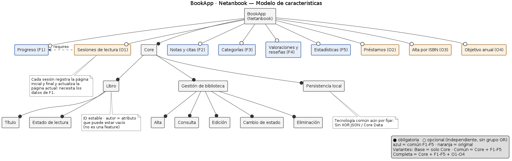

# Sesión 3 · Modelo de características y listado de libros con MVVM

**Grupo Netanbook** · Líneas de Productos Software · Universidad de Almería · curso 2026-27
Marcos Sánchez García · Javier Zúñiga Carmona · Maria Camila Soto Zapata · Daniel Arévalo Almendros

> Estado del código de esta entrega: etiqueta Git `sesion-3` (`git checkout sesion-3`).

---

## 1. Modelo de características de BookApp (Netanbook)



Fuente PlantUML: [`modelo-caracteristicas.puml`](modelo-caracteristicas.puml).
Notación: círculo relleno ● = obligatoria; círculo vacío ○ = opcional; flecha discontinua = restricción `requires`.

### 1.1 Core (obligatorio en todas las variantes)

| Característica | Contenido |
|---|---|
| **Libro** | Identificador único y estable, **título** (obligatorio, no vacío), **estado de lectura** (Pendiente, Leyendo o Terminado). El **autor** es un *atributo* del libro que puede estar vacío: no es una feature opcional y por eso no aparece como nodo ○. |
| **Gestión de biblioteca** | Alta, consulta, edición, cambio de estado y eliminación. |
| **Persistencia local** | Obligatoria. La tecnología (Core Data, SwiftData o JSON) aún no está fijada por el profesorado, así que **no** la modelamos como un XOR: cuando se decida, se añadirá debajo de este nodo. |

El Core no depende de red, de cuentas de usuario ni de ninguna feature variable.

### 1.2 Las cinco features comunes (F1–F5)

Son **hijas opcionales e independientes** de la raíz. No forman un grupo OR, porque tiene que existir la variante *Base* sin ninguna de ellas. Opcional significa que una variante del producto puede no incluirlas; todas se implementan a lo largo del curso.

| Feature | Datos mínimos | Comportamiento mínimo |
|---|---|---|
| **F1 · Progreso** | Total de páginas y página actual (`ReadingProgress`) | Registrar y actualizar la página actual; porcentaje cuando hay un total válido. |
| **F2 · Notas y citas** | Texto, tipo (nota/cita), página opcional y libro (`Note`) | Crear, listar, editar y borrar anotaciones de un libro. |
| **F3 · Categorías** | Nombre (`BookCategory`) y asignación libro–categoría (`BookCategoryAssignment`) | Crear categorías, asignarlas y filtrar la biblioteca. |
| **F4 · Valoraciones y reseñas** | Puntuación 1–5 y texto breve (`Review`) | Registrar, modificar y consultar la valoración global del libro. |
| **F5 · Estadísticas** | Datos derivados de los libros (`LibraryStatistics`) | Total de libros y número de pendientes, leyendo y terminados. Se calcula **solo con el Core**, así que no requiere F1. |

### 1.3 Features originales (una por integrante)

Salen del brainstorming de la sesión 2 (productos *Netanbook Lector* y *Netanbook Biblioteca*) y ninguna es un renombrado de F1–F5. Somos cuatro, así que hay cuatro originales; si el grupo creciera a cinco se añadiría O5 como otra hija opcional.

| Original | Qué hace | Por qué no es F1–F5 |
|---|---|---|
| **O1 · Sesiones de lectura** | Temporizador: iniciar y parar una sesión, guardar duración y páginas leídas (desde–hasta). | F1 guarda *dónde vas*; O1 guarda *cuándo y cuánto lees* en cada sesión. |
| **O2 · Préstamos** | Anotar a quién se ha prestado un libro físico, la fecha y si se ha devuelto. | Ninguna común trata la biblioteca física. |
| **O3 · Alta por ISBN** | Escribir o escanear el ISBN y rellenar título y autor desde un catálogo público. | Es otra forma de dar de alta; usa red, pero solo dentro de la feature (el Core sigue sin red). |
| **O4 · Objetivo anual** | Fijar un número de libros para el año y ver cuántos se han terminado. | F5 cuenta lo que hay; O4 compara con una meta del usuario y guarda la fecha en que se termina cada libro. |

### 1.4 Restricciones cruzadas

Solo incluimos las que responden a una dependencia real:

| Restricción | Justificación |
|---|---|
| **O1 Sesiones de lectura `requires` F1 Progreso** | Cada sesión registra la página inicial y la final, y al cerrarla actualiza la página actual del libro. Esos datos (página actual y total) pertenecen a F1; sin F1, O1 no tendría dónde leerlos ni escribirlos. |

Restricciones que **no** ponemos, a propósito:

- *F5 → F1*: las estadísticas mínimas (total y recuento por estado) se calculan con el Core. Un futuro “resumen de páginas leídas” sí requeriría F1 y se modelaría entonces.
- *O4 → F5*: el objetivo anual cuenta libros terminados con sus propios datos (fecha de fin); no necesita la pantalla de estadísticas.
- *O3 → algo*: el alta por ISBN solo rellena los campos del Core.
- No hay ningún `excludes`: no hemos encontrado dos features incompatibles.

### 1.5 Comprobación de variantes

| Variante | Selección | ¿Válida? |
|---|---|---|
| **Base** | Solo Core | ✔ ninguna feature es obligatoria y no hay grupo OR. |
| **Común** | Core + F1, F2, F3, F4, F5 | ✔ no interviene ninguna restricción. |
| **Completa** | Core + F1–F5 + O1–O4 | ✔ O1 requiere F1, que está incluida. |
| *Netanbook Lector* (ejemplo) | Core + F1 + F4 + F5 + O1 + O4 | ✔ |
| *Netanbook Biblioteca* (ejemplo) | Core + F3 + O2 + O3 | ✔ |
| Core + O1 (sin F1) | | ✘ incumple `O1 requires F1` |

---

## 2. Arquitectura MVVM y estructura del proyecto

Misma organización que el ejemplo del profesor (TaskApp-2026): una sola carpeta de código
que se compila con Xcode en Mac y con `Package.swift` en Linux y Windows.

```
bookapp-netanbook/
├── BookApp.xcodeproj                  // Mac: se abre en Xcode (SwiftUI de Apple)
├── Package.swift                      // Linux y Windows: swift run BookApp (SwiftOpenUI)
├── Compat/SwiftUI/                    // módulo «SwiftUI» que reexporta SwiftOpenUI
└── BookApp/                           // la MISMA carpeta para los tres sistemas
    ├── Application/
    │   └── BookApp.swift              // @main, WindowGroup
    ├── Core/
    │   ├── Models/
    │   │   ├── ReadingStatus.swift    // enum: Pendiente / Leyendo / Terminado
    │   │   ├── Book.swift             // struct: id, título, autor?, estado
    │   │   └── SampleLibrary.swift    // libros de ejemplo con ids fijos
    │   ├── ViewModels/
    │   │   └── BookListViewModel.swift // @Observable: colección y operaciones
    │   └── Views/
    │       └── BookListView.swift     // listado (crea el ViewModel con @State)
    ├── Features/                      // un punto de variación por carpeta
    │   ├── Progress/ReadingProgress.swift        (F1)
    │   ├── Notes/Note.swift                      (F2, boceto)
    │   ├── Categories/BookCategory.swift         (F3, boceto)
    │   ├── Reviews/Review.swift                  (F4, boceto)
    │   └── Statistics/LibraryStatistics.swift    (F5, boceto)
    └── Infrastructure/                // se creará al llegar a persistencia y plugins
        ├── Persistence/
        └── Plugins/
```

| Capa | En Netanbook | Responsabilidad |
|---|---|---|
| **Model** | `Book`, `ReadingStatus` | Datos y reglas del dominio. Swift puro: no importa SwiftUI. |
| **ViewModel** | `BookListViewModel` | Guarda la colección de libros y la modifica (`advanceStatus`, `addSampleBook`). Es `@Observable`, así que la vista se redibuja sola. |
| **View** | `BookListView` | Dibuja la lista y avisa de lo que pulsa el usuario. En la sesión 4 la fila se extrae a `BookRowView`, que recibe la acción como closure y no conoce el ViewModel. |

**Responsable del listado y de modificar el estado de los libros:** `BookListViewModel`. La vista crea el ViewModel con `@State` y lo único que hace es llamarle (por ejemplo, `viewModel.advanceStatus(id: book.id)` al pulsar el icono de estado).

### 2.1 Del modelo de características a los tipos de Swift

- El **Core** se traduce en `Book` y `ReadingStatus`. `Book` no tiene ningún campo de F1–F5.
- Cada feature tiene sus **propios tipos**, que apuntan al libro mediante `bookID: UUID`. Así el Core existe sin ellas y una variante que no las incluye no arrastra sus datos.
  - F1 `ReadingProgress(bookID, totalPages, currentPage)` con `percentage` calculado.
  - F2 `Note` y `NoteKind` (relación 1 libro → n notas).
  - F3 `BookCategory` y `BookCategoryAssignment` (relación n:m).
  - F4 `Review` (puntuación validada en 1...5; como mucho una por libro).
  - F5 `LibraryStatistics(books:)`: se calcula, no se guarda.

---

## 3. Reparto de features

> Cada integrante es responsable principal de una común y una original; el Core y la integración son de todos. Como somos cuatro, **F5** (la más pequeña, se calcula solo con el Core) la asume además Maria Camila Soto Zapata.

| Integrante | Feature común | Feature original |
|---|---|---|
| Maria Camila Soto Zapata | F1 · Progreso | O1 · Sesiones de lectura (requiere F1) |
| Marcos Sánchez García | F2 · Notas y citas | O2 · Préstamos |
| Javier Zúñiga Carmona | F3 · Categorías | O3 · Alta por ISBN |
| Daniel Arévalo Almendros | F4 · Valoraciones y reseñas | O4 · Objetivo anual |
| Maria Camila Soto Zapata | F5 · Estadísticas | — |

---

## 4. Comprobad vuestro diseño (respuestas)

**¿Qué campos del libro son obligatorios y cuáles opcionales? ¿Por qué?**
Obligatorios: `id` (la lista y las features necesitan una identidad que no cambie aunque se edite el título), `title` (sin título el usuario no puede reconocer el libro; la regla del Core es “título no vacío”) y `status` (siempre tiene valor; un libro nuevo empieza en `.pendiente`). Opcional: `author: String?`, porque hay libros de los que no se conoce o no interesa el autor.

**¿Quién guarda la colección de libros: la vista o el ViewModel?**
El ViewModel. Si la guardara la vista, la lógica de añadir, cambiar de estado o borrar acabaría dentro de la pantalla: no se podría reutilizar con otro framework de interfaz (sesión 4) ni probar sin interfaz. Con el ViewModel, añadir o borrar es un método más y la vista se actualiza sola.

**¿Podría el Core existir sin las notas, las categorías o las valoraciones? ¿Dónde se guardan entonces esos datos?**
Sí. Esos datos viven en los tipos de cada feature (`Note`, `BookCategory` + `BookCategoryAssignment`, `Review`), que apuntan al libro por `bookID`, y los gestionará el ViewModel de cada feature. `Book` no tiene ningún campo de ellas.

**¿Qué diferencia hay entre que el autor sea opcional y que F1 sea una característica opcional del producto?**
Que el autor sea opcional es un dato de **un libro concreto** (`String?`, se decide al rellenar el formulario). Que F1 sea opcional es una decisión sobre **una variante del producto** (se decide en el modelo de características y se implementará con flags o traits): en la variante sin F1 ningún libro tiene progreso, aunque el código de los libros sea el mismo.
